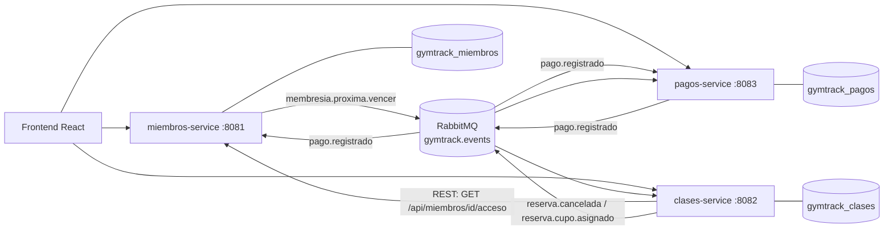

# GymTrack Backend

Backend de **GymTrack**, un sistema de gestión de gimnasio: miembros y membresías, clases con aforo y lista de espera, y pagos con notificaciones. Está construido con **Java 21 y Spring Boot**, **PostgreSQL** (una base por servicio) y **RabbitMQ**.

Proyecto de *Diseño y Arquitectura de Software* (Universidad de La Sabana). El frontend (React + TypeScript + Vite) vive en un repositorio aparte.

Martín Polo Santini - Rafael Alejandro Rincón Sarmiento - Tomás Trujillo Manby

## Contenido

- [Qué incluye](#qué-incluye)
- [Arquitectura](#arquitectura)
- [Arrancar la demo](#arrancar-la-demo)
- [Probar que funciona](#probar-que-funciona)
- [Datos de demo](#datos-de-demo)
- [Guion de la demo (6 pasos)](#guion-de-la-demo-6-pasos)
- [API](#api)
- [Eventos](#eventos)
- [Reglas de negocio y patrones](#reglas-de-negocio-y-patrones)
- [Desarrollo local](#desarrollo-local)
- [Pruebas](#pruebas)
- [Variables](#variables)
- [Persistencia y parada](#persistencia-y-parada)
- [Construcción y CI/CD](#construcción-y-cicd)
- [Prueba de disponibilidad: Pagos apagado](#prueba-de-disponibilidad-pagos-apagado)
- [Estructura del repositorio](#estructura-del-repositorio)
- [Documentación adicional](#documentación-adicional)
- [Flujo de trabajo del equipo](#flujo-de-trabajo-del-equipo)
- [Solución de problemas](#solución-de-problemas)
- [Limitaciones conocidas](#limitaciones-conocidas)

## Qué incluye

| Servicio | Puerto | Base de datos | Responsabilidad |
| --- | --- | --- | --- |
| `miembros-service` | 8081 | `gymtrack_miembros` | Miembros, membresías, planes y consulta de acceso |
| `clases-service` | 8082 | `gymtrack_clases` | Clases, reservas, aforo y lista de espera |
| `pagos-service` | 8083 | `gymtrack_pagos` | Pagos y notificaciones |
| `common` | — | — | Módulo compartido: clases de eventos, routing keys y nombre del exchange |

Infraestructura: PostgreSQL 1 instancia con 3 bases, y RabbitMQ con el exchange `topic` `gymtrack.events`.

## Arquitectura



Puntos clave:

- **Una base de datos por servicio.** Las referencias entre servicios son lógicas (`miembroId`), sin joins.
- **Comunicación híbrida.** Eventos asíncronos por RabbitMQ para pagos, vencimientos y cupos. La única llamada REST entre servicios es Clases → Miembros (`/acceso`), con timeout corto.
- **Clases no depende de Pagos.** Con Pagos apagado, el catálogo y las reservas siguen funcionando.
- **Validación previa de pagos.** `POST /api/pagos` consulta a Miembros por RabbitMQ (canal interno) antes de guardar; ver [Reglas de negocio](#reglas-de-negocio-y-patrones).
- Las decisiones y sus alternativas están en [`docs/adr/`](docs/adr/).

## Arrancar la demo

Requisitos: Git, Docker Engine con Compose v2 o Docker Desktop en modo contenedores Linux. Las imágenes de este workflow son Linux AMD64 (Intel/AMD).

Antes del primer arranque, deben haber terminado las **tres publicaciones** de imágenes en Actions sobre `main`. Un PR construye y valida; no publica. Tras la primera publicación, el propietario debe hacer públicos los tres paquetes en GitHub → Package settings → Change visibility para permitir descargas anónimas. Si se mantienen privados, el equipo deberá autenticarse para descargarlos. El CD utiliza el `GITHUB_TOKEN` automático y no requiere secretos adicionales.

```bash
git clone https://github.com/polosantini/gymtrack-backend.git
cd gymtrack-backend
docker compose pull && docker compose up -d
docker compose ps -a
```

Los valores predeterminados permiten arrancar sin `.env`. Para personalizarlos, copiar `.env.example` como `.env` antes del arranque: `cp .env.example .env` en Bash o `Copy-Item .env.example .env` en PowerShell. No subir `.env` al repositorio.

| Componente | Dirección predeterminada |
| --- | --- |
| Miembros | http://localhost:8081/api/miembros |
| Clases | http://localhost:8082/api/clases |
| Pagos | http://localhost:8083/api/pagos?miembroId=6 |
| RabbitMQ administración | http://localhost:15672 (gymtrack / gymtrack) |
| PostgreSQL | localhost:5432 |

`up -d` inicia los contenedores; esperar a que las aplicaciones terminen de arrancar. PostgreSQL y RabbitMQ tienen comprobaciones de salud.

Si aparece `denied` al descargar, revisar visibilidad y permisos del paquete. Si no existe `latest`, revisar las tres publicaciones. Si un puerto está ocupado, ajustar su variable en `.env`.

## Probar que funciona

Diagnóstico y comprobaciones HTTP:

```bash
docker compose logs --tail 100 miembros clases pagos
curl -f http://localhost:8081/api/miembros
curl -f http://localhost:8082/api/clases
curl -f "http://localhost:8083/api/pagos?miembroId=6"
```

Los tres `curl` deben responder 200 con JSON. Si alguno falla, los servicios aún pueden estar arrancando: espera unos segundos y repite, o revisa los logs.

Para probar todos los endpoints con asserts automáticos, importa la colección de Postman `GymTrack.postman_collection.json` y ejecútala con el *Collection Runner* carpeta por carpeta. Calcula solo las fechas necesarias (próximo martes) y espera los [datos de demo](#datos-de-demo) con la base limpia.

## Datos de demo

Cada servicio carga su `data.sql` al arrancar, con IDs fijos.

**Miembros** (`miembros-service`)

| id | Nombre | Plan | Estado | Para qué sirve |
| --- | --- | --- | --- | --- |
| 1 | Ana | BASICO | SUSPENDIDA | Rechazo por membresía inactiva |
| 2 | Luis | FULL | ACTIVA | Camino feliz de reservas |
| 3 | Sara | PREMIUM | SUSPENDIDA | Plan ilimitado pero sin activar |
| 4 | Diego | BASICO | ACTIVA | Primero en la lista de espera; vence en 3 días |
| 5 | Carlos | FULL | VENCIDA | `/acceso` con `activa=false` por vencida |
| 6 | María | PREMIUM | ACTIVA | Reservas sin límite |
| 7 | Pedro | — | Sin membresía | `/acceso` con `activa=false` y `plan=null` |

**Clases** (`clases-service`)

| id | Clase | Días | Hora | Aforo |
| --- | --- | --- | --- | --- |
| 1 | Spinning | Martes, jueves | 18:00 | 3 |
| 2 | Yoga | Martes, jueves | 07:00 | 10 |
| 3 | Funcional | Lunes, miércoles, viernes | 19:00 | 15 |

Las reservas de demo se calculan sobre el **próximo martes** (hoy mismo si es martes): Spinning queda **lleno** (Ana, Luis y Sara confirmados) con Diego en espera en la posición 1, y María tiene una reserva de Yoga. También hay historial de asistencia del martes anterior. Las filas de demo de Clases se refrescan en cada arranque; las reservas creadas durante la demo (id 8 en adelante) no se tocan.

Para volver a un estado limpio: `docker compose down -v && docker compose up -d` (ver [Persistencia y parada](#persistencia-y-parada)).

## Guion de la demo (6 pasos)

Duración aproximada: 10 minutos. Requiere la base limpia y los servicios arriba.

Primero calcula la fecha del próximo martes (la que usan los datos de demo):

```bash
# Linux / macOS con GNU date (en macOS: brew install coreutils y usar gdate)
FECHA=$(date -d "tuesday" +%F)
```

```powershell
# PowerShell
$d = Get-Date; while ($d.DayOfWeek -ne 'Tuesday') { $d = $d.AddDays(1) }; $FECHA = $d.ToString('yyyy-MM-dd')
```

**1. Factory Method y `pago.registrado`**: Ana paga y su membresía pasa de SUSPENDIDA a ACTIVA, con notificación.

```bash
curl -X POST http://localhost:8083/api/pagos -H "Content-Type: application/json" \
  -d '{"miembroId":1,"plan":"BASICO","periodo":"MENSUAL","monto":50000,"metodo":"EFECTIVO"}'
curl http://localhost:8081/api/miembros/1/acceso
curl "http://localhost:8083/api/notificaciones?miembroId=1"
```

**2. Strategy**: un plan Básico se rechaza en su tercera reserva de la semana y un Premium no tiene límite. Diego ya tiene una en espera (Spinning).

```bash
# 2.ª de la semana: se acepta
curl -X POST http://localhost:8082/api/reservas -H "Content-Type: application/json" \
  -d "{\"miembroId\":4,\"claseId\":3,\"fecha\":\"$(date -d "$FECHA +1 day" +%F)\"}"
# 3.ª de la semana: se rechaza
curl -X POST http://localhost:8082/api/reservas -H "Content-Type: application/json" \
  -d "{\"miembroId\":4,\"claseId\":3,\"fecha\":\"$(date -d "$FECHA +3 day" +%F)\"}"
```

**3. Aforo y lista de espera**: Spinning está lleno, así que María queda en espera con posición.

```bash
curl -X POST http://localhost:8082/api/reservas -H "Content-Type: application/json" \
  -d "{\"miembroId\":6,\"claseId\":1,\"fecha\":\"$FECHA\"}"
curl "http://localhost:8082/api/clases/1/reservas?fecha=$FECHA"
```

**4. Observer**: se cancela una reserva confirmada, el primero en espera (Diego) pasa a CONFIRMADA y recibe una notificación.

```bash
curl -X PATCH http://localhost:8082/api/reservas/1/cancelar
curl "http://localhost:8082/api/clases/1/reservas?fecha=$FECHA"
curl "http://localhost:8083/api/notificaciones?miembroId=4"
```

**5. `membresia.proxima.vencer`**: disparo manual de la tarea diaria. Diego vence en 3 días.

```bash
# Completar con la ruta real del endpoint manual de miembros-service
curl -X POST http://localhost:8081/<ENDPOINT_MANUAL>
curl "http://localhost:8083/api/notificaciones?miembroId=4"
```

**6. Pagos apagado**: Clases y Reservas siguen funcionando. Ver [Prueba de disponibilidad](#prueba-de-disponibilidad-pagos-apagado).

Además se muestra en el frontend el selector "actuar como" (administrador y miembro).

## API

Todos los errores usan un formato uniforme (400 validación, 404 no encontrado, 409 conflicto, 503 dependencia no disponible).

**Miembros** · `:8081`

| Método | Ruta | Descripción |
| --- | --- | --- |
| POST | `/api/miembros` | Crea un miembro `{nombre, email}`; email único |
| GET | `/api/miembros` | Lista miembros |
| GET | `/api/miembros/{id}` | Miembro con su membresía actual |
| POST | `/api/miembros/{id}/membresias` | Crea una membresía `{plan}`; nace SUSPENDIDA |
| GET | `/api/planes` | Planes con precios mensual, trimestral y anual |
| GET | `/api/miembros/{id}/acceso` | `{activa, plan}`; `activa=true` solo si está ACTIVA |

**Clases** · `:8082`

| Método | Ruta | Descripción |
| --- | --- | --- |
| POST | `/api/clases` | Crea una clase |
| GET | `/api/clases` | Catálogo con cupos libres por fecha |
| GET | `/api/clases/{id}/reservas?fecha=` | `confirmados[]` y `enEspera[]` (ordenada por posición) |
| POST | `/api/reservas` | Reserva `{miembroId, claseId, fecha}`: CONFIRMADA o EN_ESPERA |
| GET | `/api/reservas?miembroId=` | Reservas e historial de asistencia del miembro |
| PATCH | `/api/reservas/{id}/cancelar` | Cancela la reserva |
| PATCH | `/api/reservas/{id}/asistencia` | Marca asistencia `{asistio}` |

**Pagos y notificaciones** · `:8083`

| Método | Ruta | Descripción |
| --- | --- | --- |
| POST | `/api/pagos` | Registra un pago `{miembroId, plan, periodo, monto, metodo}` |
| GET | `/api/pagos?miembroId=` | Pagos del miembro |
| GET | `/api/notificaciones?miembroId=` | Notificaciones, de la más reciente a la más antigua |

Valores válidos: `plan` ∈ `BASICO`, `FULL`, `PREMIUM`; `periodo` ∈ `MENSUAL`, `TRIMESTRAL`, `ANUAL`. Estados de membresía: `SUSPENDIDA`, `ACTIVA`, `VENCIDA`. Estados de reserva: `CONFIRMADA`, `EN_ESPERA`, `CANCELADA`. Tipos de notificación: `CONFIRMACION_PAGO`, `VENCIMIENTO_PROXIMO`, `CUPO_LIBERADO`.

## Eventos

Exchange `topic`: `gymtrack.events`. Cada consumidor usa su propia cola y es idempotente. Las clases de evento viven en `common`.

| Evento (routing key) | Publica | Consume | Campos |
| --- | --- | --- | --- |
| `pago.registrado` | Pagos | Miembros (activa o renueva) y Pagos (notificación) | pagoId, miembroId, plan, periodo, monto, estado |
| `membresia.proxima.vencer` | Miembros | Pagos (notificación) | miembroId, nombre, fechaVencimiento, diasRestantes |
| `reserva.cancelada` | Clases | Clases (asigna el cupo) | reservaId, claseId, fecha, liberaCupo |
| `reserva.cupo.asignado` | Clases | Pagos (notificación) | miembroId, claseNombre, fecha, hora |

Los eventos se publican **después del commit**.

## Reglas de negocio y patrones

**Reglas de reserva por plan** (Strategy):

| Plan | Regla |
| --- | --- |
| BASICO | Máximo 2 reservas por semana |
| FULL | Máximo 1 reserva por día |
| PREMIUM | Sin límite |

- La semana va de lunes a domingo. Cuentan las reservas CONFIRMADA y EN_ESPERA; las CANCELADA no.
- La regla de plan se aplica antes de revisar el aforo.
- El plan lo determina Miembros (`/acceso`), nunca el que envía el cliente. Membresía inactiva responde 409.
- El aforo se cuenta por (clase, fecha). Una clase llena manda la reserva a la lista de espera, con posición por orden de llegada que no se recalcula.
- Reservar dos veces la misma (clase, fecha) responde 409.
- Concurrencia: bloqueo pesimista sobre la clase para evitar sobreventa.

**Validación previa de pagos (V2):** `POST /api/pagos` comprueba por RabbitMQ que el miembro exista y tenga membresía: 409 si no la tiene, 404 si no existe y 503 si no puede validar. En esos casos no guarda pago ni evento. Ver [canal interno y actualización](docs/correcciones/VALIDACION_PREVIA_PAGOS.md) y [compatibilidad con frontend](docs/correcciones/COMPATIBILIDAD_FRONTEND.md).

**Patrones y principios**

| Patrón / principio | Dónde |
| --- | --- |
| Factory Method (OCP, LSP) | `CreadorMembresia` y `PlanMembresia` en Miembros |
| Strategy y DIP | `ReglasReservaStrategy` y `ReservarClaseUseCase` en Clases |
| Observer | `SujetoReservas` publica `reserva.cancelada` al cancelar |
| ISP | `ClaseQueryService` separado de `ReservaService` |

El informe con archivo y línea de cada uno está en [`docs/informe/`](docs/informe/).

## Desarrollo local

Para modificar código sin construir imágenes, levanta solo la infraestructura con Docker y corre los servicios con Maven.

Requisitos: **JDK 21**, **Maven 3.9+**, Docker.

```bash
# 1. Infraestructura (Postgres y RabbitMQ)
docker compose up -d postgres rabbitmq

# 2. Compilar todo (incluye common)
mvn -B -DskipTests install

# 3. En tres terminales, un servicio por terminal
mvn -pl miembros-service spring-boot:run
mvn -pl clases-service   spring-boot:run
mvn -pl pagos-service    spring-boot:run
```

Las aplicaciones leen la configuración de las [variables](#variables) (`DB_USER`, `DB_PASSWORD`, `RABBIT_HOST`, `RABBIT_PORT`, `RABBIT_USER`, `RABBIT_PASSWORD`). Clases necesita `MIEMBROS_BASE_URL` (por ejemplo `http://localhost:8081`) para consultar `/acceso`. Arranca Miembros primero.

Para construir una imagen local de un servicio:

```bash
docker build --build-arg SERVICIO=clases-service -t gymtrack-clases:local .
```

La imagen manual sirve para desarrollo. El Compose oficial usa imágenes publicadas en GHCR.

## Pruebas

```bash
mvn -B verify          # compila los 4 módulos y corre todas las pruebas (lo mismo que la CI)
mvn test               # solo pruebas
mvn -pl clases-service test
```

Cubren, entre otras: fábrica de membresías y LSP, estrategias por plan, `/acceso`, concurrencia sobre el último cupo (`ReservaConcurrenciaTest`), idempotencia de consumidores y regresiones HTTP/AMQP.

## Variables

| Variable | Valor predeterminado | Uso |
| --- | --- | --- |
| `GHCR_NAMESPACE` | `polosantini/gymtrack-backend` | Propietario/repositorio en minúsculas |
| `IMAGE_TAG` | `latest` | Misma versión de los tres servicios |
| `DB_USER` / `DB_PASSWORD` | `gymtrack` / `gymtrack` | PostgreSQL y aplicaciones |
| `RABBIT_USER` / `RABBIT_PASSWORD` | `gymtrack` / `gymtrack` | RabbitMQ y aplicaciones |
| `POSTGRES_PORT` | `5432` | PostgreSQL en el equipo |
| `RABBITMQ_AMQP_PORT` | `5672` | AMQP en el equipo |
| `RABBITMQ_MANAGEMENT_PORT` | `15672` | Consola RabbitMQ |
| `MIEMBROS_PORT` | `8081` | HTTP Miembros en el equipo |
| `CLASES_PORT` | `8082` | HTTP Clases en el equipo |
| `PAGOS_PORT` | `8083` | HTTP Pagos en el equipo |

Compose configura los nombres internos `postgres`, `rabbitmq` y `miembros`; dentro de un contenedor, `localhost` apunta al propio contenedor. Clases recibe `MIEMBROS_BASE_URL=http://miembros:8081`. Las aplicaciones reciben `RABBIT_HOST`, `RABBIT_PORT`, `RABBIT_USER` y `RABBIT_PASSWORD` para conectar con RabbitMQ.

Para reproducir una publicación concreta, establecer `IMAGE_TAG=sha-<SHA completo del commit de main publicado>`. Se publica también `latest`; esperar a que terminen los tres jobs antes de usarlo para evitar mezclar versiones durante la publicación. En un fork, ajustar `GHCR_NAMESPACE` al propietario/repositorio del fork en minúsculas.

Las credenciales predeterminadas son para la demo local; personalizarlas antes de exponer la infraestructura a otros equipos.

## Persistencia y parada

`docker/postgres/init.sql` crea `gymtrack_miembros`, `gymtrack_clases` y `gymtrack_pagos` al inicializar un volumen vacío. PostgreSQL conserva sus datos en `postgres-data`. El esquema lo genera Hibernate (`ddl-auto=update`, sin Flyway).

```bash
docker compose stop
docker compose start
# Eliminar contenedores y red conservando datos:
docker compose down
```

No utilizar `docker compose down -v` como parada normal: elimina los datos. Solo úsalo cuando quieras **reiniciar la demo desde cero** (recarga los datos de demo limpios). Cambiar credenciales en `.env` no cambia automáticamente usuarios ya creados en un volumen existente. El script de inicialización tampoco vuelve a ejecutarse sobre ese volumen.

## Construcción y CI/CD

El Dockerfile raíz recibe `ARG SERVICIO`, compila el módulo seleccionado junto con `common` y copia el JAR ejecutable a Java 21 JRE, con usuario sin privilegios. Valores: `miembros-service`, `clases-service` y `pagos-service`.

El workflow `.github/workflows/ci.yml` ejecuta:

1. `ci`: `mvn -B -U "-Dmaven.repo.local=${RUNNER_TEMP}/m2-gymtrack" verify` en PR y push a `main`.
2. `validar-docker`: después de CI correcta, valida Compose, construye los tres servicios sin publicar, levanta la demo y comprueba los tres endpoints HTTP. Muestra logs si falla y limpia los contenedores al terminar.
3. `publicar-imagenes`: solo en push a `main`, después de ambos jobs correctos, publica una imagen por servicio con `latest` y `sha-<SHA completo>`. Usa `GITHUB_TOKEN`, permiso `packages: write` y namespace convertido a minúsculas.

Los tests se ejecutan en CI; la construcción de imágenes omite repetirlos. No se requiere PAT ni secretos nuevos para el workflow. Publicar en GHCR no despliega en la nube.

Referencia: [publicación y visibilidad de paquetes GHCR](https://docs.github.com/en/packages/working-with-a-github-packages-registry/working-with-the-container-registry).

## Prueba de disponibilidad: Pagos apagado

Con la demo arrancada, la prueba de disponibilidad usa este mismo Compose:

```bash
docker compose stop pagos
# Comprobar catálogo y una reserva válida con miembro activo.
docker compose start pagos
```

Mantener Miembros, PostgreSQL y RabbitMQ encendidos. La prueba completa está en [la guía de #40](docs/informe/40-pagos-apagado.md). Con los cinco servicios arrancados, ejecutar desde la raíz:

```powershell
pwsh -NoProfile -File ./scripts/demo/probar-pagos-apagado.ps1
```

En Windows también se puede utilizar `powershell -NoProfile -File .\scripts\demo\probar-pagos-apagado.ps1`. El script detecta los puertos publicados, requiere un miembro Premium ya activo (por defecto María, id 6), crea una clase nueva, detiene Pagos, comprueba catálogo/reserva/error controlado y restaura Pagos al finalizar. Conserva la clase y la reserva como evidencia; no modifica membresías ni elimina datos.

El job `Validar Docker y arranque` ejecuta esta prueba después del arranque HTTP y conserva un artefacto JSON. Una ejecución con `resultado=OK` es la evidencia de Docker; agregar el procedimiento no equivale a haberlo ejecutado correctamente.

## Estructura del repositorio

```text
gymtrack-backend/
├── pom.xml                      # POM padre (4 módulos, Java 21)
├── common/                      # Eventos, routing keys y exchange
├── miembros-service/            # :8081
├── clases-service/              # :8082
├── pagos-service/               # :8083
├── Dockerfile                   # Genérico: ARG SERVICIO
├── docker-compose.yml           # Postgres, RabbitMQ y los 3 servicios
├── .env.example                 # Variables personalizables
├── docker/postgres/init.sql     # Crea las 3 bases
├── scripts/demo/                # Scripts de la demo (Pagos apagado)
├── docs/
│   ├── adr/                     # Decisiones de arquitectura
│   ├── diagrams/                # Clases, componentes y secuencia
│   ├── informe/                 # Informe de patrones, SOLID y guías de prueba
│   └── correcciones/            # Correcciones de integridad y validación de pagos
└── .github/workflows/ci.yml     # CI, validación Docker y publicación a GHCR
```

## Documentación adicional

- [Decisiones de arquitectura (ADR)](docs/adr/README.md)
- [Informe de patrones y SOLID](docs/informe/)
- [Guía de #40: Pagos apagado](docs/informe/40-pagos-apagado.md)
- [Compatibilidad con el frontend](docs/correcciones/COMPATIBILIDAD_FRONTEND.md)

## Flujo de trabajo del equipo

- Nadie sube directo a `main`: cada cambio entra por **Pull Request**.
- Para fusionar se necesita **CI en verde y 1 aprobación**. La misma regla aplica al repo del frontend.
- Los contratos de endpoints y eventos están aprobados; cualquier cambio posterior se anota en el hilo del issue de contratos el mismo día.
- Responsables: Martín Polo y Alejandro Rincón en backend, Tomás Trujillo en frontend.

## Solución de problemas

| Síntoma | Causa probable | Solución |
| --- | --- | --- |
| `denied` al hacer `docker compose pull` | Paquetes GHCR privados o no publicados | Hacer públicos los tres paquetes o autenticarse en GHCR |
| `manifest unknown` / no existe `latest` | Las tres publicaciones no han terminado | Revisar Actions sobre `main` |
| `port is already allocated` | Puerto ocupado en el equipo | Cambiar la variable de puerto en `.env` |
| `curl` falla justo después de `up -d` | Las aplicaciones aún arrancan | Esperar y revisar `docker compose logs --tail 100 miembros clases pagos` |
| Reservas devuelven 409 con Ana o Sara | Sus membresías están SUSPENDIDAS en los datos de demo | Usar Luis, Diego o María, o activar el miembro pagando |
| Reservas devuelven 503 | Miembros no responde a `/acceso` | Comprobar que `miembros` esté arriba |
| Pago devuelve 503 | Pagos no puede validar con Miembros por RabbitMQ | Comprobar RabbitMQ y Miembros |
| 409 al repetir un paso de la demo | Las reservas creadas antes persisten | `docker compose down -v && docker compose up -d` |
| Cambié `DB_PASSWORD` y no entra | El volumen conserva las credenciales viejas | Reiniciar el volumen con `down -v` (borra datos) |
| Los servicios no conectan entre contenedores | Uso de `localhost` dentro del contenedor | Usar los nombres `postgres`, `rabbitmq` y `miembros` |
| Las reservas de demo no coinciden con mi fecha | Se anclan al próximo martes | Calcular `FECHA` como se explica en la demo |

## Limitaciones conocidas

- **Sin autorización real.** El selector "actuar como" del frontend envía `X-Role` y `X-User-Id` solo como etiqueta visual; no hay JWT ni validación en el backend.
- **Sin Outbox.** Los eventos se publican después del commit; si un servicio cae justo entre el commit y la publicación, un evento puede perderse. Ver las correcciones de eventos pendientes en [`docs/correcciones/`](docs/correcciones/LEEME_BACKEND_CORREGIDO.md).
- **Sin migraciones versionadas.** El esquema lo gestiona `ddl-auto=update`.
- **Notificaciones simuladas.** Se guardan en tabla y log; no se envían correos reales.
- **Sin API Gateway.** El proxy de Vite (desarrollo) y nginx (producción) enrutan a los tres puertos.
- Credenciales predeterminadas solo para la demo local.
